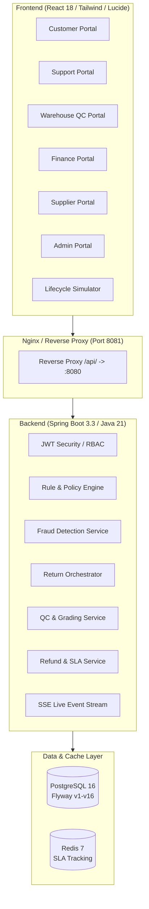

# ReturnFlow — Enterprise Return & Refund Processing Management System (RRPMS)

[](https://openjdk.org/)
[](https://spring.io/projects/spring-boot)
[](https://react.dev/)
[](https://vitejs.dev/)
[](https://tailwindcss.com/)
[](https://www.postgresql.org/)
[](https://redis.io/)
[](https://www.docker.com/)
[](LICENSE)

**ReturnFlow** is an enterprise-grade, end-to-end Reverse Logistics & Refund Management Platform designed to streamline product returns, enforce multi-tiered return policies, detect fraud, orchestrate warehouse quality control, automate financial refunds, and reconcile supplier liabilities.

---

## Architecture Overview



---

## Key Enterprise Portals

ReturnFlow provides 6 dedicated, role-tailored portals equipped with real-time state synchronization and access control:

| Portal | Primary Persona | Key Capabilities |
| :--- | :--- | :--- |
| **Customer Portal** | `CUSTOMER` | Self-service return initiation, visual milestone tracking, doorstep pickup rescheduling, refund method preference (Original vs. Store Credit), and instant Credit Note PDF export. |
| **Support Portal** | `CUSTOMER_SUPPORT` | Customer order lookup, initiate returns on customer's behalf, policy window evaluation, and authorized return window override management. |
| **Warehouse QC Portal** | `WAREHOUSE_QC` | Barcode scanning, item verification, condition grading (`MINT`, `GOOD`, `FAIR`, `DAMAGED`, `DEFECTIVE`), photographic evidence capture, and disposition routing (`RESTOCK`, `LIQUIDATE`, `RTM`). |
| **Finance Portal** | `FINANCE` | Multi-tiered refund approval queue (thresholds > ₹10,000), gateway disbursement status tracking, net liability dashboards, and GST credit note generation. |
| **Supplier Portal** | `SUPPLIER_MANAGER` | Return to Merchant (RTM) batch management, defect root-cause analysis, supplier credit settlement velocity, and realized credit recovery. |
| **Admin Portal** | `ADMIN` | Dynamic return policy hierarchy (Category / Brand / SKU / Customer Tier), real-time RBAC policy simulator, comprehensive audit logs, user management, and executive analytics. |

---

## Technical Highlights

- **Dynamic Policy Resolution Engine**: Cascading precedence resolution across Customer Tier, SKU, Brand, and Category levels. Supports window extensions, free return flags, and exchange eligibility.
- **Real-Time Lifecycle Simulator**: Interactive visual demonstration workbench (`/demo/lifecycle`) allowing instant simulation of the entire 8-stage reverse logistics lifecycle.
- **Rule-Based Fraud Detection**: Real-time evaluation for high return velocity, repeated empty box claims, serial discrepancy, and policy abuse with automated blacklisting and hold flags.
- **Bank-Grade PDF Generation**: Native PDF generation for Credit Notes, Tax Invoices, and QC Inspection Reports with clean CSS print optimization (no full-page browser prints).
- **Server-Sent Events (SSE)**: Real-time broadcast stream for multi-portal synchronization upon return status updates.
- **Robust Database Migrations**: 16 version-controlled Flyway migrations ensuring reproducible database schemas.

---

## Technology Stack

### Backend
- **Runtime**: Java 21 (OpenJDK / Eclipse Temurin)
- **Framework**: Spring Boot 3.3.2
- **Persistence**: Spring Data JPA / Hibernate 6.5, PostgreSQL 16
- **Database Migrations**: Flyway 10
- **Cache & SLA Tracking**: Redis 7, Spring Data Redis
- **Security**: Spring Security 6 with JWT (HMAC-SHA512)
- **Validation**: Jakarta Validation (Hibernate Validator)
- **Build System**: Maven 3.9 (Multi-module root aggregator)

### Frontend
- **Framework**: React 18.3 (Vite 5.4 build system)
- **Styling**: Tailwind CSS 3.4 + Custom UI Design System
- **Icons**: Lucide React
- **Charts & Dashboards**: Recharts
- **PDF & Export**: jsPDF + html2canvas
- **HTTP Client**: Axios with JWT interceptors & error handlers

---

## Getting Started

### Option A: Complete Stack via Docker (Recommended)

Run the entire system (Frontend, Backend, PostgreSQL, and Redis) with a single command:

```bash
# Clone repository
git clone https://github.com/baladeepak04/Return-Refund-Processing-Management-System.git
cd Return-Refund-Processing-Management-System

# Build and start all 4 services in the background
docker compose up --build -d
```

#### Access Endpoints
- **Frontend Web Application**: [http://localhost:8081](http://localhost:8081)
- **Backend REST API**: [http://localhost:8080](http://localhost:8080)
- **PostgreSQL Database**: `localhost:5432` (`rrpms_db`)
- **Redis Cache**: `localhost:6379`

To view live container logs:
```bash
docker compose logs -f
```

To stop the stack:
```bash
docker compose down
```

---

### Option B: Local Development Setup (Manual)

#### 1. Start Infrastructure (PostgreSQL & Redis)
```bash
docker compose up -d postgres redis
```

#### 2. Start Backend (Spring Boot)
Open a terminal in the root folder:
```bash
cd rrpms-backend
mvn spring-boot:run
```
*Backend runs on `http://localhost:8082`*

#### 3. Start Frontend (Vite Dev Server)
Open a second terminal in the root folder:
```bash
cd rrpms-frontend
npm install
npm run dev
```
*Frontend runs on `http://localhost:5173` with instant hot-module reload.*

---

## Pre-Seeded Demo Accounts

The system automatically initializes 6 pre-seeded role accounts for immediate testing. All accounts share the same password:

> **Default Password**: `Password123!`

| Role | Email | Default Dashboard |
| :--- | :--- | :--- |
| **System Administrator** | `admin@returnflow.io` | `/admin/dashboard` |
| **Customer** | `priya@example.com` | `/customer/dashboard` |
| **Customer Support Agent** | `rahul.support@returnflow.io` | `/support/dashboard` |
| **Warehouse QC Inspector** | `deepak.qc@returnflow.io` | `/qc/dashboard` |
| **Finance Officer** | `kavita.finance@returnflow.io` | `/finance/dashboard` |
| **Supplier Manager** | `sunita.supplier@returnflow.io` | `/supplier/dashboard` |

---

## REST API Overview

| Method | Endpoint | Description | Role Required |
| :--- | :--- | :--- | :--- |
| `POST` | `/api/v1/auth/login` | Authenticate user & receive JWT token | Public |
| `GET` | `/api/v1/returns` | List returns (filtered by customer or global) | Authenticated |
| `POST` | `/api/v1/returns` | Initiate a new return request | `CUSTOMER`, `SUPPORT` |
| `POST` | `/api/v1/returns/{id}/pickup` | Schedule logistics doorstep pickup | `CUSTOMER`, `SUPPORT` |
| `POST` | `/api/v1/qc/inspections` | Submit item quality inspection & grade | `WAREHOUSE_QC` |
| `POST` | `/api/v1/refunds/{id}/approve` | Approve high-value refund disbursement | `FINANCE` |
| `POST` | `/api/v1/refunds/{id}/credit` | Mark refund credited / gateway sync | `FINANCE` |
| `GET` | `/api/v1/policies` | List active return policies | Authenticated |
| `POST` | `/api/v1/policies` | Create or update return policy | `ADMIN` |
| `GET` | `/api/v1/fraud/queue` | Review flagged suspect returns | `ADMIN`, `FINANCE` |
| `GET` | `/api/v1/analytics/dashboard` | System-wide return velocity & financial KPIs | `ADMIN`, `FINANCE` |

---

## Project Structure

```
Return-Refund-Processing-Management-System/
├── .github/
│   └── workflows/
│       ├── ci.yml                    # Automated build & test pipeline
│       └── docker-publish.yml        # Automatic GHCR container image publishing
├── docker-compose.yml                # Production multi-container definition
├── docker-compose.dev.yml            # Dev-mode hot-reload overlay
├── pom.xml                           # Root multi-module Maven POM
├── rrpms-backend/                    # Spring Boot 3.3 Backend
│   ├── Dockerfile
│   ├── pom.xml
│   └── src/
│       ├── main/java/com/returnflow/rrpms/
│       │   ├── config/               # Security, CORS, Seeders
│       │   ├── controller/           # REST API Endpoints
│       │   ├── dto/                  # Data Transfer Objects
│       │   ├── entity/               # JPA Entities
│       │   ├── enums/                # Business Domain Enums
│       │   ├── exception/            # Centralized Exception Handling
│       │   ├── repository/           # Spring Data JPA Repositories
│       │   └── service/              # Core Business Logic & Orchestration
│       └── main/resources/
│           ├── db/migration/         # Flyway Migrations (V1 to V16)
│           └── application.yml       # Application Configuration
└── rrpms-frontend/                   # React 18 + Vite Frontend
    ├── Dockerfile
    ├── nginx.conf                    # Production reverse proxy config
    ├── package.json
    ├── tailwind.config.js
    └── src/
        ├── components/               # UI components, modals, simulator
        ├── portals/                  # Role-specific portal views
        ├── lib/                      # API client, PDF generation, context
        └── pages/                    # Home, Login, Global Platform Shell
```

---

## License

This project is licensed under the MIT License - see the [LICENSE](LICENSE) file for details.
